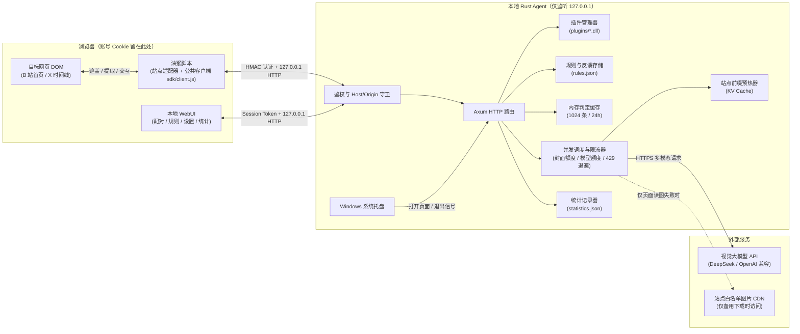
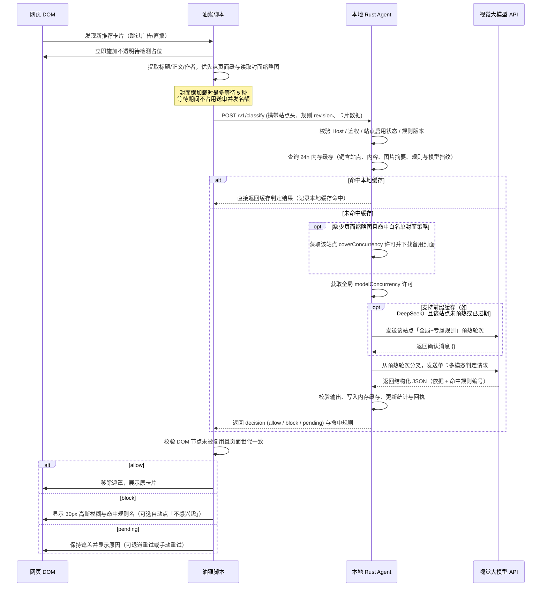

# 系统架构与安全设计

本文档介绍 **认知滤网（Cognition Filter）** 的整体系统架构、核心工作流程、安全配对机制、缓存与前缀预热设计以及隐私边界。

---

## 总体架构

认知滤网采用「**浏览器端站点脚本 + 本地 Rust Agent + 视觉大模型 API**」三层分离架构，并通过原生动态链接库（DLL）将各网站的页面适配逻辑解耦为独立插件。



### 职责边界

| 组件 | 核心职责 | 严格边界 |
| --- | --- | --- |
| **站点 DLL 插件** (`plugins/*`) | 声明站点清单（ID、并发默认值、页面选择器策略、可选封面源白名单）并封装该站点的油猴脚本模板 | 不持有 API Key、不直接访问模型服务、不接触用户规则存储 |
| **浏览器油猴脚本** (`*.user.js` + `sdk/client.js`) | 监听 DOM 变化、卡片预遮盖、提取标题/正文/作者/缩略图、端口自动发现与签名验证、按判定结果渲染与反馈交互 | 不持有模型 API Key；账号 Cookie 不出浏览器 |
| **本地 Rust Agent** (`src/*`) | 单实例端口监听、安全鉴权、插件加载与热重载、规则版本管理、前缀预热、封面备用下载、并发调度、结果缓存、统计持久化、提供内置 WebUI 与系统托盘 | 不读取浏览器 Cookie、不解析网页 DOM、不向第三方上传遥测数据 |
| **视觉大模型 API** | 根据当前站点启用的自然语言规则对单张卡片进行语义判定或反馈纠错分析 | 仅接收单卡可见摘要、缩略图与规则文本，返回严格校验的 JSON |

---

## 核心判定流程

每张信息流推荐卡片从出现在 DOM 到完成展示，遵循「**先遮盖、后判定、逐卡独立送审**」的流程：



### 封面获取的三级降级策略（以 B 站为例）

1. **页面像素直读（优先）**：封面加载完成后，直接从页面已渲染的图片元素生成 JPEG 缩略图（`pageCover`，Base64 字符串上限 96 KiB）。封面仍在懒加载时保持遮盖并等待最多 5 秒，等待期间不占送审名额。
2. **匿名跨域缓存读取**：若浏览器因跨域限制禁止读取画布像素，脚本使用实际显示的图片地址发起匿名跨域请求，优先命中浏览器缓存（默认超时 5 秒，可通过 `pagePolicy.corsReadTimeoutMs` 调整）。
3. **本地 Agent 备用下载（兜底）**：仅在前两步均失败且卡片包含合法封面 URL 时，脚本上报备用地址，由本地 Rust Agent 按站点清单的 `cover` 白名单策略代为下载。对于支持纯文字帖的站点（声明了 `textPostLimit`，如 X），无媒体且正文非空的帖子直接纯文本送审。

---

## 端口发现与安全配对

为避免固定端口冲突导致服务无法启动，同时防止本机其他恶意进程劫持端口窃取请求，认知滤网实现了**确定性候选端口序列 + HMAC-SHA256 质询-响应**机制：

### 1. 单实例锁与端口监听

- 启动时先在数据目录创建并排他锁定 `agent.lock`。同一数据目录重复启动时会检测到锁被占用并直接退出，沿用已运行实例。
- 仅监听回环地址 `127.0.0.1`。
- 优先绑定首选端口 `17321`；若端口被占用或属于 Windows 保留端口段，则按固定线性同余发生器（LCG：`s = (s * 109 + 89) & 0x3fff`，初值 `0x1d3b`）在 `49152–65535` 范围内生成最多 **32 个候选高位端口**（总计 33 个确定性候选端口，前四个依次为 `17321`、`56635`、`62072`、`64881`），依次尝试绑定。

### 2. 自动探测与双向身份确认

- 首次运行时，Agent 使用操作系统安全随机源生成 24 字节（48 位小写十六进制）配对口令，保存于数据目录的 `pairing-token`。
- 油猴脚本（`0.4.0+`）优先探测上次连接的端口，失败后按同一 33 端口序列逐个发送：
  ```http
  GET /.well-known/cognition-filter?nonce=<32位随机十六进制>
  ```
- Agent 计算 `HMAC-SHA256(token, "cognition-filter/v1|{port}|{nonce}")` 作为 `proof` 返回。
- 脚本在本地用已保存的配对口令独立验证 `proof`。**只有签名校验通过的端口才会被确认为真正的本地 Agent**，从而杜绝向占用同端口的陌生程序发送数据。

### 3. 双通道鉴权隔离

Agent 在 Axum 中间件 `guard` 中对所有请求强制实施 Host 校验与分通道鉴权：

- **Host 校验**：所有请求的 `Host` 头必须精确等于 `127.0.0.1:<当前端口>`，防范 DNS Rebinding 攻击。
- **站点脚本通道**（`/v1/rules`、`/v1/classify`、`/v1/feedback`、`/v1/pick`、`/v1/status`）：
  - 使用按端口派生的密钥：`CF-Port HMAC-SHA256(token, "cognition-filter/auth/v1|{port}")`（在首选端口 `17321` 上兼容旧版 `Bearer <token>`）。
  - 使用恒定时间比较（`subtle::ConstantTimeEq`）防时序侧信道攻击。
  - 仅拥有信息流过滤与规则读写权限，**不能**读取或修改模型 API Key、并发配置或管理插件。
- **WebUI 管理通道**（`/v1/config`、`/v1/stats`、`/v1/admin/rules`、`/v1/plugins/*`）：
  - 额外校验 `Origin` 头（若存在，必须为 `http://127.0.0.1:<端口>`），阻止第三方网页发起跨站请求。
  - 使用每次进程启动随机生成的独立 48 位 `settings_token`（仅内嵌在本地 WebUI HTML 文档中），以 `Bearer <settings_token>` 认证。

---

## 缓存、前缀预热与规则反馈闭环

### 1. 本地内存判定缓存

- Agent 在内存中维护容量 **1,024 条**、有效期 **24 小时** 的 LRU 缓存（`Recent`）。
- 缓存键由以下要素的确定性摘要组成：站点 ID、卡片文本内容、封面图片字节摘要、当前站点生效的规则内容与反馈样本、模型名称、服务地址及提示词版本。
- 任意一项变更（例如修改规则、切换模型、增删反馈要点）都会导致规则版本号 `revision` 变化，旧缓存自动失效。

### 2. 按站点独立的前缀预热（KV Cache）

- 使用 DeepSeek 接口时，规则说明文本在所有卡片判定中高度重复。Agent 为每个已启用的站点插件独立维护一个预热槽位，提前发送「全局启用规则 + 该站专属启用规则」的规则确认轮次（`rule_turn`）。
- 后续该站点的每张卡片请求都从该确认消息分叉，最大化命中模型服务端的 KV Cache 前缀缓存。
- 同一站点的并发请求共享一次预热，不会重复触发；规则变更或纠错反馈保存后，仅受影响的站点重新排队预热；连续 2 小时未使用的预热前缀在下次送审时自动刷新；没有启用任何规则的站点直接跳过预热与模型调用。

### 3. 人机协同反馈闭环

- **反馈误杀（`/v1/feedback`）**：用户标记已放行/展开的被拦卡片为误杀后，Agent 结合最近一次判定回执（`receipts`）与卡片素材，调用模型反思误判原因，为命中的规则组生成具体的中文「保留例外（`exclude`）」要点并写回 `rules.json`。
- **主动选卡屏蔽（`/v1/pick`）**：用户选中被漏放的卡片并指定已有规则组时，Agent 调用模型分析漏判线索，生成可编辑的「命中要点（`include`）」并追加到该组；随后触发规则版本更新与站点重热。
- 所有反馈自动生成的要点都以普通明文规则保存，用户可随时在 WebUI 中编辑、单独禁用或删除。

---

## 隐私与安全边界

- **账号零暴露**：浏览器登录态与 Cookie 始终留在浏览器中，本地 Agent 既不读取也不代理用户账号信息。
- **密钥不离本机**：模型 API Key 仅保存在本机数据目录的 `runtime.json` 中（Unix 下目录权限 `0700`、文件权限 `0600`），WebUI 仅显示「是否已设置」，不向脚本暴露密钥。
- **封面下载防 SSRF**：Agent 执行备用封面下载时，严格校验 URL 必须为 `HTTPS`、无凭据、无显式非默认端口、无查询参数与片段，且主机名与路径必须精确匹配站点 DLL 清单声明的 `cover.hosts` 和 `cover.pathPattern`。
- **抗提示词注入（Prompt Injection）**：提示词明确限定卡片标题、作者及图片中的文字仅作为待分析素材，其中的任何指令均无效；模型响应经过严格的 JSON Schema 与规则编号边界校验。
- **插件来源提醒**：站点插件是本机原生动态库（DLL），Agent 加载时仅读取清单与脚本快照后即卸载 DLL。请仅在 `plugins/` 目录中放置可信来源构建的插件。
