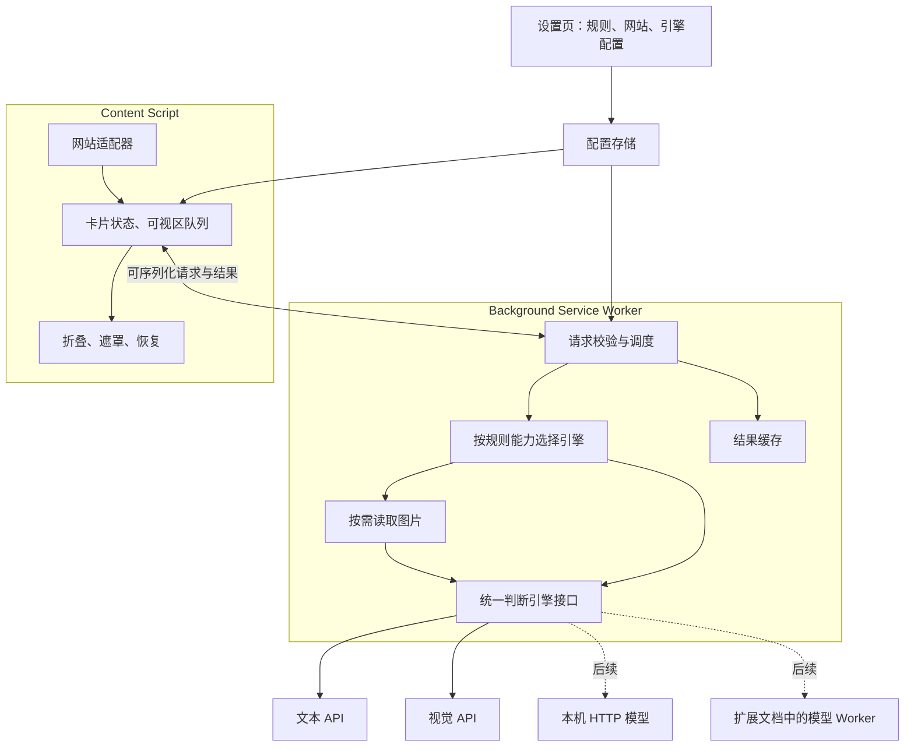

# Cognition Filter MVP 架构设计

> 这份文档记录早期扩展方案。当前实现采用油猴脚本、本地 Rust agent 和先遮盖后判定的流程，安装及现行行为见 [项目说明](../README.md)。

采用 WXT + TypeScript，以浏览器扩展实现逐网站适配的语义内容过滤。首版通过 API 判断文本和图像，网站适配器与判断引擎使用独立接口，后续可接入本机 HTTP 服务或浏览器内模型。

本方案以桌面 Chrome / Edge、自用或小规模测试、用户自带 API Key 为初始部署假设。网站和具体视觉 API 尚待选择，这两项通过注册模块和配置接入。

## MVP 范围

- 以信息流卡片为过滤单位，分析适配器实际提取的标题、摘要或正文片段，以及静态图片；首版每个适配器固定声明分析范围，图片默认仅封面。保留提取范围和缺失信息。
- 用户创建自然语言规则，选择适用网站及文本、图像、图文联合判断方式；可启停、编辑和删除。
- 命中后折叠或遮罩，显示命中规则并提供临时展开；站点可单独暂停。
- 首版接入一个真实网站、一个文本 API 引擎和一个视觉 API 引擎，通过第二个简单适配器验证扩展边界。
- 首版不实现视频理解、自动适配网站、账户同步、计费服务、向量数据库、模型微调或浏览器模型下载管理。

## 运行结构



页面拥有待判断卡片和 DOM 状态；后台负责凭据、跨域请求、共享限流及缓存。后台重启后由仍打开的页面重新提交有效任务，无需恢复旧页面任务队列。Chrome 的后台 Service Worker 会在空闲等条件下终止，不能依赖全局变量永久存在。[生命周期文档](https://developer.chrome.com/docs/extensions/develop/concepts/service-workers/lifecycle)

代码分为四个职责边界：

| 模块 | 负责 | 边界 |
| --- | --- | --- |
| SiteAdapter | 找到卡片、提取快照、管理站点特有的 DOM 绑定和呈现方式 | 不持有密钥，不选择模型 |
| ContentController | 可视区调度、去重、卡片状态、版本校验、执行展示策略 | 不直接调用供应商 API |
| BackgroundGateway | 校验消息、读取可信配置、处理素材、缓存、限流、调用引擎 | 不接触页面 DOM |
| EvaluationEngine | 转换模型请求、解析并校验响应、返回逐条规则判断 | 不返回选择器、HTML、脚本或 DOM 操作 |

## 项目组织

以下为建议目录，只有本架构文档在当前阶段落地。使用 WXT 的 srcDir 配置。[WXT 项目结构](https://wxt.dev/guide/essentials/project-structure)

```text
src/
  entrypoints/
    background.ts
    filter.content.ts
    popup/
    options/
  domain/
    content.ts
    rules.ts
    evaluation.ts
    decision.ts
  sites/
    catalog.ts
    registry.ts
    types.ts
    shared/
    first-site/
  content/
    controller.ts
    scheduler.ts
    bindings.ts
    renderer.ts
  background/
    gateway.ts
    router.ts
    scheduler.ts
  engines/
    types.ts
    registry.ts
    jev-api.ts
    vision-api.ts
  assets/
    resolver.ts
  storage/
    settings.ts
    credentials.ts
    cache.ts
  messaging/
    protocol.ts
    schemas.ts
tests/
  fixtures/
  adapters/
  engines/
  e2e/
docs/
  mvp-architecture.md
```

domain 只依赖 TypeScript 数据类型和纯函数。网站目录可以依赖 domain 和适配器契约，引擎目录可以依赖 domain 和引擎契约；两者互不依赖。WXT 入口仅组装模块。设置页的 UI 框架不影响这些边界。

## 内容与规则模型

快照可以跨扩展消息传输；DOM 引用只保存在 content script。contentKey 表示同一站点的同一内容，bindingId 表示某个 DOM 展示实例，同一内容可以有多个展示实例。

```ts
type InputMode = "text" | "image" | "multimodal";
type Verdict = "match" | "no-match" | "uncertain";

interface ContentSnapshot {
  siteId: string;
  adapterVersion: string;
  contentKey: string;
  revision: string;
  text: { title?: string; body?: string; author?: string };
  images: Array<{ id: string; sourceUrl: string; alt?: string }>;
  coverage: {
    text: "visible-card" | "full-post" | "missing";
    images: "cover-only" | "visible-images" | "missing";
    incomplete: boolean;
  };
}

interface FilterRule {
  id: string;
  version: number;
  enabled: boolean;
  instruction: string;
  inputMode: InputMode;
  siteIds: string[];
}

interface RuleEvaluation {
  ruleId: string;
  verdict: Verdict;
  reason?: string;
  evidence?: Array<
    | { type: "text"; quote: string }
    | { type: "image"; imageId: string }
  >;
}
```

每条规则描述“满足什么条件时过滤”，例外写在同一条规则中。siteIds 为空表示适用于所有已启用且受支持的网站。首版不加入独立保留规则、优先级或通用逻辑表达式编辑器。

例如“过滤制造职场焦虑的内容，但保留提供具体操作建议的内容”作为一个完整判断条件；将来可以由规则编译器拆成子问题，但拆解结果须保留条件关系和版本，不能直接对各子问题取 OR。

inputMode 决定输入模态：text 使用文字；image 使用图片；multimodal 在同一个判断中使用文字与图片。图文联合规则不能拆成两次独立调用后简单取 OR。MVP 由用户选择输入方式，避免引入额外的自动路由模型。

MVP 的规则统一作用于该网站适配器声明的卡片范围，规则接口不单独配置全文或图库要求。设置页显示各站点实际分析范围，例如“标题、摘要和封面”；给模型的指令也限定于此范围。coverage.incomplete 表示声明范围内的内容未能完整取得，不因主动选择卡片范围而自动标记 incomplete。读取失败或被容量限制截断时，受影响任务返回未完成，不能宣称已经判断整篇帖子。

## 网站适配器契约

采用注册表加模块的方式扩展网站。站点元数据包含主机匹配规则、支持的页面类型、图片 CDN 白名单和适配器版本；构建时据此生成内容脚本匹配范围及相关权限声明。

```ts
interface SiteAdapter {
  id: string;
  version: string;
  supports(url: URL): boolean;
  start(context: AdapterContext): () => void;
}

interface AdapterContext {
  root: Document;
  signal: AbortSignal;
  upsert(snapshot: ContentSnapshot, binding: CardBinding): void;
  remove(bindingId: string): void;
}

interface CardBinding {
  id: string;
  generation: number;
  element: HTMLElement;
  present(state: "pending" | "collapsed", label?: string): void;
  restore(): void;
}
```

通用辅助模块提供容器观察、增量扫描、节流和默认呈现器。站点适配器只在 DOM 结构、内容提取和虚拟列表布局上做必要定制。Controller 统一调用 binding.present / restore，并安装展开按钮。

适配器必须满足以下生命周期规则：

1. 启动时扫描当前列表，再监听卡片新增、内容变化、图片加载及容器替换。
2. 元素复用为新内容时先恢复旧展示，再更新 contentKey、revision 和 binding.generation；不能用 WeakSet 判断一个元素永远处理完毕。
3. SPA 路由变化时停止旧实例、取消旧任务、恢复展示，再判断新路由是否受支持。主机级注入与路由级启停分别处理，可使用 WXT 的 wxt:locationchange。
4. 清理函数负责断开所有 Observer、清除自己创建的 UI 和计时器；扩展上下文失效时同样清理。
5. 只观察目标列表，忽略扩展自身 UI 的变更。虚拟列表优先在卡片内部遮罩或保留占位，避免破坏外层高度测量。

这些生命周期与 WXT 的 content script context 配合实现。[WXT Content Scripts](https://wxt.dev/guide/essentials/content-scripts)

## 判断引擎契约

文本引擎与视觉引擎共用一个接口，以能力声明区分。首版只有静态 registry，不做运行时下载插件或独立的多层 Provider 框架。供应商协议、请求模板和输出解析封装在具体引擎中，公共 HTTP 工具可以复用。

```ts
interface ImageAsset {
  id: string;
  mimeType: string;
  bytes: ArrayBuffer;
  digest: string;
}

interface EvaluationRequest {
  requestId: string;
  input: {
    text: ContentSnapshot["text"];
    imageIds: string[];
    coverage: ContentSnapshot["coverage"];
  };
  rules: FilterRule[];
}

interface EvaluationResponse {
  evaluations: RuleEvaluation[];
  resolvedModel?: string;
  usage?: { inputTokens?: number; outputTokens?: number };
}

interface EvaluationEngine {
  id: string;
  fingerprint: string;
  runtime: "remote-http" | "local-http" | "browser";
  capabilities: {
    inputModes: InputMode[];
    maxImages: number;
    maxInputTokens?: number;
  };
  evaluate(
    request: EvaluationRequest,
    assets: ImageAsset[],
    signal: AbortSignal,
  ): Promise<EvaluationResponse>;
}
```

引擎实例绑定模型及可信配置。fingerprint 覆盖协议与实现版本、endpoint、模型、影响判断的参数、prompt/schema 版本、阈值或校准版本；不包含 API Key。

首版注册 JevApiEngine 处理 text，VisionApiEngine 处理 image 和 multimodal。具体视觉供应商确定后实现对应协议；只有确认请求格式和结构化输出能力兼容的服务才共用 HTTP 实现。原生协议差异留在引擎内部。

后台按 inputMode 和配置将一张卡片的规则分组，一次 evaluate 评估同组多个规则。一次 evaluate 不保证只产生一个供应商 HTTP 请求；需要拆分时，每个实际 HTTP 请求都必须经过共享限流器，并共享原任务截止时间。遇到不支持的输入、素材缺失或超出限制时显式返回运行错误，不偷偷去掉图片或截断文字后当作完整判断。适配器声明封面范围时，结果只覆盖封面；声明范围内证据不完整的任务保留未完成状态。

所有响应须通过运行时 schema 校验：规则 ID 必须来自本次请求，不能重复或缺失；verdict 必须为枚举；引用的图片 ID 必须存在；理由限长。缺项属于 invalid-response。页面文本和图片文字作为待分析数据，不能控制模型指令、请求地址或输出 schema。

首版不定义通用 confidence 字段。Jev 的概率可在引擎内部按经过验证的阈值映射为三态结果；相似度、模型自报分数和已校准概率不能共用一个阈值。Laya 或视觉 embedding 后续也必须遵守同一约束。无需模型给出理由时，UI 直接显示命中规则名称。

## 请求与展示流程

1. Adapter 发现或更新卡片，Controller 建立 DOM 绑定与快照。
2. Controller 将接近视口的卡片排入队列，后台根据当前配置找出适用规则；没有适用规则时不发模型请求。
3. 后台校验 sender、站点、请求体和配置版本，按规则能力分组；仅图片相关任务读取素材。
4. 生成缓存键，命中则返回；未命中进入后台的有界队列，再调用对应引擎。
5. 后台校验结果、缓存可用判断，返回带请求版本信息的响应。
6. Controller 校验 binding、内容和配置仍一致，再以纯函数聚合规则结果并呈现。

消息采用 EVALUATE / CANCEL / GET_STATUS / CONFIG_CHANGED，结构使用 TypeScript 联合类型加 Zod 等运行时 schema。每个任务信封携带 requestId、pageSessionId、routeGeneration、bindingId、bindingGeneration、contentKey、contentRevision 和 configRevision。后台从消息 sender 获取 tab/frame 身份，不能信任调用方伪造的 tabId。

AbortSignal 只在各执行上下文内使用；取消消息引用 requestId，后台查找自己的 AbortController。初版不跨标签页合并正在执行的请求，避免引入共享任务的订阅与取消管理；已完成结果可以共用缓存。

| 条件 | 展示行为 |
| --- | --- |
| 任一规则明确 match | 折叠或遮罩，并展示命中的规则 |
| 所有适用规则均 no-match | 保留 |
| 没有 match，至少一条 uncertain | 保留，标记判断不确定 |
| 没有 match，存在超时、素材或通信错误 | 保留，标记检测未完成，允许重试 |
| 用户临时展开 | 保持展开，当前内容版本内不被异步结果重新折叠 |

运行失败和语义不确定分别记录。某条规则明确命中时，不必等待其他无关规则全部成功才能折叠；同一规则的例外条件必须已经在该规则判断中处理。

普通模式默认在判断完成前显示原内容，减少滚动干扰。另提供“等待检测时遮罩”开关，保留卡片高度；超过展示等待上限就恢复，并终止本轮自动展示更新，迟到结果只能缓存或供手动重试使用。动态网页不承诺零闪烁。

以下为待实测调整的初始预算：每标签页最多 2 个任务执行，后台最多 4 个 API 调用；文本总截止时间 8 秒、图像 15 秒，均包含排队和重试。等待遮罩上限分别为 2 秒与 5 秒。页面关闭、路由变化、内容复用和规则变更时取消旧任务；跨越最终截止时间的结果不再影响页面。

## 图片与凭据

AssetResolver 负责将适配器提供的图片引用转换为 ImageAsset。使用站点明确支持的 CDN，校验 MIME 和实际字节数，设置每图及每任务总大小上限；图片数量按引擎能力和适配器声明的分析范围限制。需要缩放或转码时再增加独立的图像处理宿主，首版优先使用站点已有的合适尺寸图片。

进入引擎时，图片按本次输入顺序重新编号为 image-1、image-2 等规范化 ID，并保留到当前快照图片 ID 的映射。引擎返回和缓存保存规范化 ID，返回页面前再映射为当前快照 ID，避免同一图片字节被另一张卡片复用时携带过期引用。

首版只接入可通过受支持 HTTPS 图片地址读取的静态图片；登录态、反盗链、blob URL 或素材缺失均显示未完成。API 引擎将已取得的字节编码为供应商要求的格式；未来浏览器模型直接消费字节。不将整个页面截图或完整 HTML 发送给模型。

跨 Chrome runtime 消息优先传 URL、assetId 和其他 JSON 数据。ImageAsset 的 ArrayBuffer 是同一执行上下文内的引擎入参，不能直接假定它可通过 Chrome 消息传输。后台需要相应 host_permissions 才能跨域取图，不能提供任意 URL 代理。[网络请求](https://developer.chrome.com/docs/extensions/develop/concepts/network-requests)、[消息序列化](https://developer.chrome.com/docs/extensions/develop/concepts/messaging)

用户在设置页输入自己的 API Key，默认仅保存在 storage.session；选择记住后存入 storage.local，并限制为 TRUSTED_CONTEXTS。规则和站点配置也由后台向 content script 提供不含凭据的视图。密钥不进入页面 DOM、content script、日志、导出配置或 storage.sync；本地扩展存储不等于操作系统密钥保险箱。[storage 文档](https://developer.chrome.com/docs/extensions/reference/api/storage)

初版请求地址和图片域由已注册模块及用户在设置页保存的可信配置决定。发布统一付费服务时增加后端代理保存服务方密钥，并在代理实现认证和额度；可新增代理引擎接入，网站适配层无需改变。

## 缓存与恢复

持久配置使用 storage.local。首版结果缓存使用有界 storage.session，建议从最多 500 条、总大小 2 MiB、TTL 24 小时开始；同时限制条目数与实际字节数。仅保存 digest、规则判断、短理由及模型标识，默认不保存正文、图片字节和完整模型响应。浏览器重启或扩展重载后缓存可以丢弃。

缓存键取以下信息的确定性摘要：

```text
siteId + adapterVersion + normalizationVersion
+ 实际送入模型的文字和 coverage
+ 按输入顺序排列的实际图片字节 digest
+ 适用规则内容及版本
+ engineFingerprint
```

contentRevision 用于判断页面内容是否改变，图像缓存另以字节 digest 为准；URL 相同不能证明图片内容没变。刷新或重新提取时按 HTTP 缓存规则重新验证图片，首版不承诺检测一个 URL 在当前 DOM 完全不变时被服务器静默换图。

缓存保存原始规则判断，展示设置修改时可重新应用；规则、模型或判断阈值变更时重新评估。固定模型版本优先；可变 alias 使用更短 TTL，并记录实际返回的模型版本。运行错误不作为 no-match 缓存。

页面队列与后台执行队列均为内存状态。后台重启或通信断开后，页面只重新提交仍存在、仍适用且未超过截止时间的卡片。瞬时网络错误、429、5xx 最多重试一次，并遵循 Retry-After 和总截止时间；认证错误、无权限、格式错误不重试。重新提交可能产生重复 API 调用，不宣称恰好一次计费；手动重试是新的任务预算。

## 本地模型扩展路径

| 后续方案 | 新增实现 | 复用部分 |
| --- | --- | --- |
| 本机 Laya HTTP 服务 | LayaLocalEngine，声明 text 能力并转换输出 | 网站、规则、队列、缓存、展示 |
| 本机多模态服务 | LocalVisionEngine 或已确认兼容的 HTTP 引擎配置 | 图像素材处理、任务格式、输出校验 |
| 浏览器内文本或视觉模型 | BrowserEngineProxy 和模型宿主 | 同一引擎契约与规则结果格式 |

浏览器内模型由扩展文档中的专用 Worker 承载，必要时使用 offscreen document 的相应能力；不把大模型绑定到可随时回收的后台 Service Worker。跨扩展上下文传 assetId，由宿主读取临时 IndexedDB 字节，再向 Worker 传递 ArrayBuffer；任务结束后清理素材。模型宿主需要独立的加载状态、取消和内存管理，但这些不进入网站适配器。[offscreen 文档](https://developer.chrome.com/docs/extensions/reference/api/offscreen)

本地模式应明确禁止自动回退到云端；只有用户启用云端回退策略后才允许上传。模型切换引起 fingerprint 改变，旧判断不会直接复用。

## 实现顺序与验收

1. 搭建 WXT、domain 契约、消息 schema、存储接口及 MockEngine，先完成卡片发现到可恢复折叠的闭环。
2. 接入首个真实网站，验证滚动加载、SPA 路由、节点复用和扩展关闭后的恢复；配置页支持规则及站点开关。
3. 实现 Jev 文本 API、超时取消、缓存和凭据配置；准备人工标注的中文规则样本验证过滤效果。
4. 实现一个视觉 API 与 AssetResolver，验证图片模式及图文联合模式，补充素材获取失败和缺失证据场景。
5. 用第二个简单网站适配器和第二个兼容测试引擎验证：新增网站无需改引擎，新增引擎无需改网站代码。

验收重点是可观察行为：迟到响应不能折叠另一张卡片；修改规则不能沿用旧判断；图像失败不能标记为已安全检查；不支持的网站不启动过滤；后台重启后页面可重新调度；临时展开不被覆盖；同样的文本、图片、规则和模型可命中缓存。

测试分为适配器 DOM fixtures、引擎响应契约、规则聚合与缓存失效、浏览器端到端流程。语义效果另以真实标注样本评测误杀率、漏放率、逐模式 P95 耗时和每千条成本；工程测试通过不能代替语义评测。
